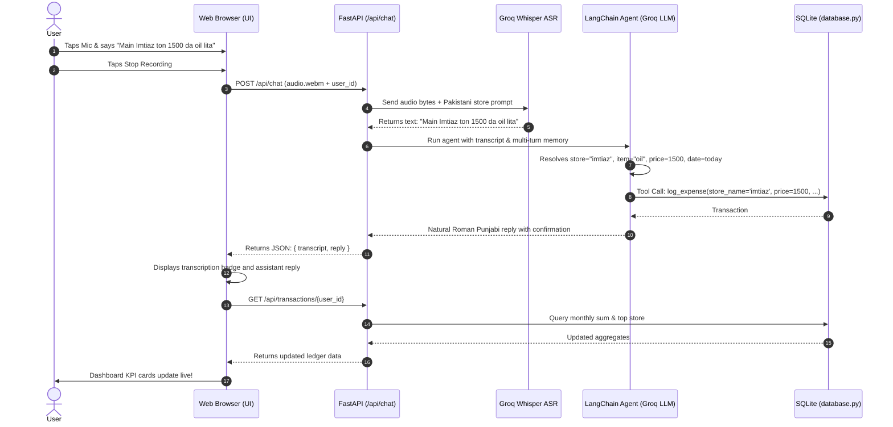

# 📖 HisaabAI — Complete Codebase Explanation Guide

Welcome to the comprehensive, beginner-friendly guide to the **HisaabAI** codebase. This document breaks down every file, every package, and every programming keyword used in this project into simple, plain English.

---

## 📑 Table of Contents
1. [Architecture Overview: How Everything Connects](#1-architecture-overview)
2. [Packages & Libraries Explained](#2-packages--libraries-explained)
3. [Programming Keywords Explained](#3-programming-keywords-explained)
4. [File-by-File Detailed Breakdown](#4-file-by-file-detailed-breakdown)
   - [database.py (Database & Tables)](#databasepy)
   - [agent.py (AI Brain, Whisper, & Tools)](#agentpy)
   - [main.py (FastAPI Web Server & APIs)](#mainpy)
   - [templates/index.html (User Interface & Audio)](#templatesindexhtml)
   - [.env and .env.example (Configuration)](#env-and-envexample)
5. [End-to-End Request Flow (How a voice note becomes a saved expense)](#5-end-to-end-request-flow)

---

## 1. Architecture Overview

HisaabAI is divided into three distinct layers:

```
┌─────────────────────────────────────────────────────────────┐
│                 1. FRONTEND (User Interface)                │
│  templates/index.html (HTML5, TailwindCSS, MediaRecorder)    │
│  - Captures microphone audio & typed text                   │
│  - Sends requests to /api/chat                              │
│  - Displays live ledger dashboard                           │
└──────────────────────────────┬──────────────────────────────┘
                               │ HTTP Requests (JSON / FormData)
                               ▼
┌─────────────────────────────────────────────────────────────┐
│                 2. BACKEND (Web & AI Logic)                 │
│  main.py (FastAPI Routes)                                   │
│  agent.py (Groq Whisper + LangChain Agent)                  │
│  - Transcribes voice notes into text                        │
│  - Language detection (Urdu, Punjabi, English)              │
│  - Uses AI tools to calculate prices and dates              │
└──────────────────────────────┬──────────────────────────────┘
                               │ SQLAlchemy ORM Queries
                               ▼
┌─────────────────────────────────────────────────────────────┐
│                 3. DATA LAYER (Storage)                     │
│  database.py (SQLite DB: expenses.db)                       │
│  - transactions table (Store, user_id, date, total)        │
│  - transaction_items table (Item names, prices, categories) │
└─────────────────────────────────────────────────────────────┘
```

---

## 2. Packages & Libraries Explained

Here is why each package in `requirements.txt` was selected and what role it plays:

| Package | What it is | Why we use it in HisaabAI |
| :--- | :--- | :--- |
| **`fastapi`** | Modern Python Web Framework | Powers our backend web server. It handles incoming HTTP requests from the browser, validates inputs, and returns JSON data. |
| **`uvicorn`** | ASGI Web Server | The engine that runs FastAPI. It allows the server to handle multiple asynchronous requests simultaneously. |
| **`python-multipart`** | Form Data Parser | Enables FastAPI to receive binary files (such as `.webm` audio recordings from the microphone) and form fields together. |
| **`groq`** | Groq Cloud SDK | Connects to Groq's high-speed inference platform. We use it to run `whisper-large-v3` for speech-to-text. |
| **`langchain`** | AI Orchestration Framework | Coordinates the conversational agent, manages tools, and connects the LLM with Python functions. |
| **`langchain-core`** | Core LangChain Interfaces | Provides foundational classes like `HumanMessage`, `AIMessage`, and the `@tool` decorator. |
| **`langchain-groq`** | Groq + LangChain Bridge | Allows LangChain agents to use Groq chat models (`ChatGroq`) with tool-calling capabilities. |
| **`sqlalchemy`** | Object-Relational Mapper (ORM) | Translates database rows into normal Python objects (`tx.store_name`, `tx.total_amount`) so we don't have to write error-prone raw SQL queries. |
| **`pydantic`** | Data Validation & Schemas | Validates data types. We use it to tell the AI exactly what arguments each tool expects (e.g., `store_name: str`, `price: float`). |
| **`python-dotenv`** | Environment Variable Loader | Reads sensitive API keys and configuration settings from the `.env` file into `os.environ`. |
| **`jinja2`** | HTML Templating Engine | Allows FastAPI to serve our `templates/index.html` file to the web browser. |

---

## 3. Programming Keywords Explained

Throughout the codebase, specific Python and JavaScript keywords are used. Here is what they mean:

### Python Keywords

- **`async` / `await`**:
  - *Meaning:* Asynchronous programming.
  - *Why used:* Normal functions block everything while waiting (e.g., waiting for audio to upload or waiting for the Groq API). `async` functions allow the server to handle other users' requests while waiting for slow network operations to finish.
  
- **`def`**:
  - *Meaning:* "Define Function".
  - *Why used:* Declares a reusable block of Python code (e.g., `def transcribe_audio(...)`).

- **`class`**:
  - *Meaning:* Blueprint for creating objects.
  - *Why used:* Defines database tables (`class Transaction(Base):`) and validation schemas (`class LogExpenseInput(BaseModel):`).

- **`yield`**:
  - *Meaning:* Produces a value temporarily and pauses execution.
  - *Why used:* Used in `get_db()`. It provides a database connection to FastAPI, waits until the API finishes using it, and then resumes to close the connection in `finally`.

- **`try` / `except` / `finally`**:
  - *Meaning:* Error handling block.
  - *Why used:* If something fails (e.g., invalid audio format, Groq API rate limit), the `except` block catches the error gracefully instead of crashing the server. The `finally` block runs cleanup tasks (like closing database sessions).

- **`lambda`**:
  - *Meaning:* A quick, anonymous one-line function.
  - *Why used:* Used when sorting candidate models by ID without writing a full `def` function.

- **`global`**:
  - *Meaning:* Tells Python to access or modify a variable defined at the file's top level.
  - *Why used:* Used in `_VALIDATED_MODEL` so once a working Groq model is found, all future agent calls reuse it instantly.

- **`@decorator`** (e.g., `@tool`, `@app.get`, `@app.post`):
  - *Meaning:* A special wrapper function that adds extra capabilities to the function below it.
  - *Why used:* `@app.get("/")` tells FastAPI "run this function when someone visits this URL in their browser". `@tool` tells LangChain "allow the AI agent to call this Python function".

### JavaScript (Frontend) Keywords

- **`const` / `let`**:
  - *Meaning:* Declares variables. `const` is for values that do not get reassigned; `let` is for values that change over time.
- **`navigator.mediaDevices.getUserMedia`**:
  - *Meaning:* The standard browser API to request microphone access from the user.
- **`MediaRecorder`**:
  - *Meaning:* The browser tool that records audio bytes while the user is speaking and bundles them into an audio file (`audio/webm`).
- **`fetch()`**:
  - *Meaning:* Sends HTTP requests in the background from JavaScript to our FastAPI backend without reloading the web page.

---

## 4. File-by-File Detailed Breakdown

---

### `database.py`
This file configures our local SQLite database and defines our data models.

* **Lines 1–19: Imports & Setup**
  * Loads `DATABASE_URL` from `.env` (defaults to `sqlite:///./expenses.db`).
  * `create_engine()`: Connects Python to the SQLite database file.
  * `check_same_thread=False`: Necessary for SQLite when used with FastAPI because FastAPI handles web requests across multiple threads.
  * `SessionLocal`: A factory that produces fresh database sessions for each request.
  * `Base = declarative_base()`: The base class that all database tables inherit from.

* **Lines 22–50: `Transaction` Table Model**
  * Represents a single receipt or shopping trip.
  * Columns:
    * `id`: Unique identifier (1, 2, 3...) for each transaction.
    * `user_id`: Identifies which user made this expense (enforces multi-user isolation).
    * `store_name`: Lowercase canonical name of the store (e.g. `"imtiaz"`, `"local store"`).
    * `total_amount`: Total bill in PKR.
    * `transaction_date`: Date and time the purchase occurred.
    * `raw_transcript`: The original speech/text input from the user (useful for history).
  * `items = relationship("TransactionItem", cascade="all, delete-orphan")`: Links this transaction to its individual line items. If a transaction is deleted, all its items are automatically deleted too (cascade delete).

* **Lines 53–78: `TransactionItem` Table Model**
  * Represents each individual item bought inside a transaction.
  * Columns:
    * `transaction_id`: Foreign key pointing to `transactions.id`.
    * `item_name`: Canonical name of the item (e.g., `"cooking oil"`, `"milk"`).
    * `category`: Broad category (e.g., `"groceries"`, `"dairy"`, `"fuel"`).
    * `price`: Price in PKR.
    * `quantity`: Number of units, kg, or liters.

* **Lines 81–94: Helper Functions**
  * `init_db()`: Creates the tables in SQLite if they don't already exist.
  * `get_db()`: Dependency function used by FastAPI endpoints to open and safely close a database session.

---

### `agent.py`
This file contains the AI intelligence: speech-to-text, model resilience, custom tools, and the LangChain reasoning agent.

* **Lines 1–55: Model Management & Whisper Setup**
  * `groq_client = Groq(...)`: Connects to Groq Cloud.
  * `get_chat_llm()`: Dynamically verifies which model is available on the user's Groq tier (tries `llama-3.3-70b-versatile`, falls back gracefully to `qwen/qwen3.8-27b` if needed) and caches the validated model so there is no delay on future calls.

* **Lines 57–85: Speech-to-Text (`transcribe_audio`)**
  * Receives audio bytes from the user's microphone.
  * Sends the audio to Groq's `whisper-large-v3` model.
  * **Domain Prompt Injection:** Sends a prompt hint mentioning Pakistani stores (*Imtiaz, Al-Fatah, Jalal Sons, Carrefour, Metro*) and Urdu/Punjabi expense terms so Whisper transcribes local dialect words accurately.

* **Lines 88–180: Pydantic Tool Input Schemas**
  * `LogExpenseInput`: Defines the structure the AI must supply when saving an expense (`store_name`, `items`, `total_amount`, `date_str`). Accepts flexible item formats (lists of dicts, strings, etc.) so model variations never crash.
  * `QueryExpensesInput`: Defines filters for querying expenses (`start_date`, `end_date`, `store_name`, `item_name`, `category`).
  * `DeleteLastTransactionInput`: Confirmation flag for undoing the last entry.

* **Lines 185–270: Dynamic System Prompt (`build_system_prompt`)**
  * Injects current real-world calendar context into the prompt: today's date, yesterday's date, 2/3 days ago, and the start of the current month.
  * Instructs the agent to resolve relative words:
    * *"aaj"* $\rightarrow$ today
    * *"kal"* $\rightarrow$ yesterday
    * *"pichle do din"* $\rightarrow$ last 2 days
    * *"is mahine"* $\rightarrow$ current month
  * **Zero Interrogation Policy:** Instructs the bot to default to `"local store"` if no store is named, and to interpret phrases like *"bs enj hi add krle"* as an immediate instruction to log the expense.
  * **Script Mirroring:** If the user speaks/writes Urdu script, the agent replies in Urdu script. If Roman Urdu/Punjabi, it replies in Roman Urdu/Punjabi.

* **Lines 275–470: User-Scoped Tools (`get_tools_for_user`)**
  * **Tenant Isolation:** Creates tool functions inside a Python closure that locks in `user_id`. The LLM cannot change or spoof the `user_id`.
  * `log_expense`: Computes item sums, stores the transaction in SQLite, and returns a JSON receipt.
  * `query_expenses`: Searches SQLite transactions by date, store, or item and calculates totals.
  * `delete_last_transaction`: Finds and deletes the user's latest transaction.

* **Lines 475–540: Agent Runner & Memory (`run_agent`)**
  * Manages multi-turn conversation memory.
  * Builds the list of previous messages and invokes the LangChain ReAct agent graph.
  * Returns the final assistant message back to `main.py`.

---

### `main.py`
This file is the FastAPI web server. It connects the frontend with the database and AI agent.

* **Lines 1–45: Initialization**
  * Initializes FastAPI, sets up logging, mounts static files (`/static`), and configures HTML templates.
  * Calls `init_db()` at startup to ensure SQLite tables are ready.

* **Lines 48–54: Home Route (`GET /`)**
  * Renders `templates/index.html` when a user navigates to the web app in their browser.

* **Lines 57–130: Chat Endpoint (`POST /api/chat`)**
  * Accepts `multipart/form-data`:
    * `user_id`: Username/identifier.
    * `message`: Optional typed text.
    * `audio`: Optional voice note from the microphone.
    * `history`: Conversation history JSON string for multi-turn context.
  * If audio is present, calls `transcribe_audio()`.
  * Runs `run_agent()` and returns `{ user_id, transcript, reply }` as JSON.

* **Lines 133–140: Clear History (`POST /api/chat/clear`)**
  * Clears the active conversation context for the specified user.

* **Lines 143–200: Live Ledger API (`GET /api/transactions/{user_id}`)**
  * Computes the user's monthly spending total using SQL `SUM()`.
  * Counts total visits and identifies their top store.
  * Fetches the 25 most recent transactions with item details to populate the right-hand dashboard in the web UI.

* **Lines 203–235: Delete Transaction (`DELETE /api/transactions/{user_id}/{transaction_id}`)**
  * Deletes a specific transaction belonging strictly to that `user_id`.

---

### `templates/index.html`
This is the single-page responsive Web UI.

* **Head Section (Lines 1–65):**
  * Imports TailwindCSS via CDN for styling.
  * Imports Lucide Icons for clean UI icons (wallet, mic, store, trash, etc.).
  * Imports `marked.js` so the AI's markdown formatting (bold, bullet points) renders as rich HTML.
  * Sets up custom dark mode surface colors (`#0f172a`, `#1e293b`, `#10b981`).

* **Microphone Permission Guide Modal (Lines 75–125):**
  * Displays a guided troubleshooting popup if the browser ever blocks microphone access or if the page was opened on `0.0.0.0`.

* **Navbar & User Switcher (Lines 130–185):**
  * Contains the app branding and an input field to switch `user_id`.
  * Includes quick-switch buttons for users (`bakar`, `ali`, `home`).

* **Left Pane: Chat & Voice (Lines 190–280):**
  * Displays chat message bubbles.
  * Displays suggestion chips (*"Try: Main aaj Imtiaz ton 1500 da cooking oil..."*).
  * Shows a pulsing recording banner with a live timer (`00:05`) when recording voice.
  * Message composer with text box, Send button, and Microphone button.

* **Right Pane: Live Expense Ledger (Lines 285–365):**
  * KPI Cards: *This Month's Spending (PKR)*, *Total Visits*, *Top Store*.
  * Store breakdown tags.
  * Scrollable list of recent transactions with line items and trash/delete buttons.

* **JavaScript Client Logic (Lines 370–850):**
  * **Auto-Redirect:** Automatically redirects `0.0.0.0` to `localhost` to satisfy Google Chrome's Secure Context requirement for microphone access.
  * `startRecording()` / `stopRecording()`: Uses browser `MediaRecorder` API to capture microphone audio into Opus-encoded WebM blobs.
  * `sendChatRequest()`: Sends text and audio blobs to `/api/chat` using `FormData`.
  * `fetchDashboard()`: Reloads the ledger metrics and transaction list automatically whenever an expense is logged or deleted.

---

### `.env` and `.env.example`
* Stores environment configuration variables:
  * `GROQ_API_KEY`: Your private key from [console.groq.com](https://console.groq.com).
  * `GROQ_LLM_MODEL`: Preferred model (e.g., `llama-3.3-70b-versatile` or `qwen/qwen3.8-27b`).
  * `DATABASE_URL`: Location of SQLite database (`sqlite:///./expenses.db`).
  * `APP_HOST` and `APP_PORT`: Network host (`0.0.0.0`) and port (`8000`).

---

## 5. End-to-End Request Flow

Here is what happens under the hood when a user records a voice note:



---

## 6. How to Run the App

1. **Activate the virtual environment:**
   ```bash
   source .venv/bin/activate
   ```
2. **Start the web server:**
   ```bash
   uvicorn main:app --host 0.0.0.0 --port 8000 --reload
   ```
3. **Open in your browser:**
   ```
   http://localhost:8000
   ```
   *(Always use `localhost` so Google Chrome allows microphone access!)*

